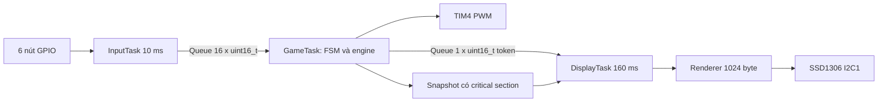

# Kiến trúc tích hợp

Task/Queue được tạo duy nhất trong main.c bởi CubeMX. Không thêm Task diagnostics hoặc buzzer. Ba wrapper gọi module trong USER CODE. GameTask ngủ tối đa 20 ms, thức sớm theo deadline gravity. RTOS SysTick 1 kHz; HAL tick TIM2. Chỉ DisplayTask truy cập I2C1, chỉ GameTask điều khiển game/PWM. Kernel còn Idle/Timer service nội bộ.

Xem docs/MODULES.md và docs/test-results/SYSTEM_V1.md; chưa kiểm thử board.
